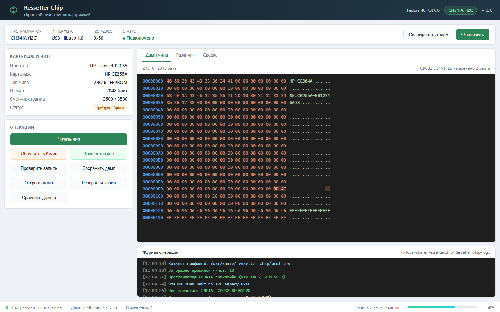

<div align="center">


# Resetter Chip

**Сброс счётчиков и обслуживание EEPROM картриджей лазерных принтеров и МФУ: CH341A, совместимые платы и самодельный программатор**

[](https://github.com/flytimopheev-sketch/resetter-chip/actions/workflows/ci.yml)
[](https://github.com/flytimopheev-sketch/resetter-chip/releases/latest)
[](https://github.com/flytimopheev-sketch/resetter-chip/releases)
[](LICENSE)
[](https://www.qt.io/)
[](https://github.com/flytimopheev-sketch/resetter-chip/releases)

[Возможности](#-возможности) · [Оборудование](#-поддерживаемое-оборудование) · [Установка](#-установка) · [Использование](#-использование) · [Профили](#-профили) · [Сборка](#-сборка-из-исходников) · [Документация](docs/) · [Участие](CONTRIBUTING.md)

</div>



<p align="center"><sub>Макет интерфейса, повторяющий компоновку окна приложения (<a href="packaging/app_mockup.html">packaging/app_mockup.html</a>).</sub></p>

---

## 📖 О проекте

**Resetter Chip** — графическое приложение на C++17 и Qt 6 для обслуживания
чипов EEPROM, которые устанавливаются в картриджи лазерных принтеров и МФУ.
Приложение читает дамп, показывает его в HEX-редакторе, обнуляет счётчик
страниц по профилю картриджа, записывает исправленный дамп и автоматически
проверяет результат.

Поддерживаются:

- **CH341A** и CH341A-совместимые USB-платы в режиме I2C;
- платы с нестандартным **VID/PID** — идентификаторы можно указать вручную;
- **самодельный программатор** на Arduino/ESP с прошивкой из этого репозитория
  и бинарным протоколом по последовательному порту.

```
Дамп EEPROM → HEX-редактор → сброс счётчика → автоматическая резервная копия
            → запись только изменённых блоков → автоматическая верификация
```

## ✨ Возможности

| | Возможность |
|---|---|
| 📖 | Чтение EEPROM `24C01 … 24C1024` с корректной адресацией (включая 24C1024) |
| 🔄 | Обнуление счётчика страниц по смещению из профиля картриджа |
| ✍️ | Постраничная запись с пропуском неизменённых блоков — меньше износ чипа |
| 🛡️ | Проверка защищённых и разрешённых зон перед записью |
| 💾 | **Автоматическая резервная копия перед каждой записью** |
| ✅ | **Автоматическая верификация после каждой записи** |
| 🧮 | HEX-редактор: правка байтов, подсветка изменений, переход к адресу, поиск, заполнение |
| 🗂️ | Контейнер дампа `RSCHIPD1` с метаданными и CRC32 + совместимость с сырыми `.bin` |
| 🔍 | Сканирование шины I2C и выбор адреса `0x50–0x57` |
| 🔌 | Три режима адаптера: CH341A авто, CH341A со своим VID/PID, последовательный DIY |
| 📋 | Журнал операций, лог-файл, прогресс и отмена длительной операции |
| 🧩 | JSON-профили чипов и картриджей без пересборки приложения |
| 🧵 | Безопасное завершение рабочего потока и повторные попытки обмена |

## 🔌 Поддерживаемое оборудование

| Компонент | Поддержка |
|---|---|
| CH341A | Режим I2C, автоопределение PID `5512`, `5523`, `5535`, `5572` |
| CH341A-совместимые | Любой VID/PID, указанный в формате `ch341a:VID:PID` |
| Самодельный | Arduino Uno/Nano/Leonardo, ESP8266, ESP32 + прошивка `firmware/resetter-serial-i2c` |
| Шина | I2C, 7-битная адресация, адреса `0x50–0x57` |
| Чипы | EEPROM `24Cxx`: 24C01, 24C02, 24C04, 24C08, 24C16, 24C32, 24C64, 24C128, 24C256, 24C512, 24C1024 |
| ОС | Linux с RPM-пакетами: Fedora, RED OS и совместимые дистрибутивы |
| Зависимости | Qt 6 (Core, Widgets), libusb-1.0 |

> [!IMPORTANT]
> Перед работой с боевыми картриджами проверьте чтение и запись на тестовом
> чипе. Приложение всегда сохраняет резервную копию перед записью, но
> ответственность за содержимое картриджа остаётся на операторе.

### Самодельный последовательный программатор

Схема подключения и прошивка:

```
EEPROM 24Cxx          Arduino / ESP
  SDA   ─────────────  SDA (A4 / GPIO4 / GPIO21)
  SCL   ─────────────  SCL (A5 / GPIO5 / GPIO22)
  GND   ─────────────  GND
  VCC   ─────────────  3.3 В или 5 В (по datasheet чипа)
```

SDA/SCL подтягиваются к питанию резисторами 4.7 кОм, если их нет на модуле.
Прошивка: [`firmware/resetter-serial-i2c/resetter-serial-i2c.ino`](firmware/resetter-serial-i2c/resetter-serial-i2c.ino).
Протокол: [`docs/PROTOCOL.md`](docs/PROTOCOL.md). Скорость порта — 115200 8N1.

## 🚀 Установка

### Готовый RPM-пакет

В релизе отдельные пакеты для Fedora 40 и RED OS 7.3: они собраны с разными
версиями Qt и glibc.

**Fedora 40** (Qt 6.8, glibc 2.39):

```bash
sudo dnf install ./Resetter-chip-1.1.0-1.fc40.x86_64.rpm
```

**RED OS 7.3** (Qt 6.6, glibc 2.28):

```bash
sudo dnf install ./Resetter-chip-1.1.0-1.redos7.x86_64.rpm
```

Пакет `fc40` на RED OS не установится: ему нужны Qt 6.8 и glibc 2.39.
Пакет `redos7` собран внутри RED OS 7.3 и использует системные Qt 6.6
и libusbx. Подробнее о сборке — в [`docs/BUILD_REDOS.md`](docs/BUILD_REDOS.md).

Для доступа к CH341A без `root` установите udev-правило (оно входит в пакет):

```bash
sudo cp /usr/lib/udev/rules.d/99-ch341a.rules /etc/udev/rules.d/
sudo udevadm control --reload-rules && sudo udevadm trigger
```

После этого переподключите программатор. Для последовательного адаптера
пользователь должен иметь доступ к `/dev/ttyUSB0` или `/dev/ttyACM0`
(обычно группа `dialout`).

### Из исходников

```bash
sudo dnf install cmake gcc-c++ qt6-qtbase-devel libusb1-devel pkgconf-pkg-config
git clone https://github.com/flytimopheev-sketch/resetter-chip.git
cd resetter-chip
cmake -B build -DCMAKE_BUILD_TYPE=Release -DBUILD_TESTS=ON
cmake --build build -j"$(nproc)"
ctest --test-dir build --output-on-failure
sudo cmake --install build
```

## 🧭 Использование

1. Подключите программатор и вставьте чип картриджа в переходник.
2. В панели подключения выберите адаптер:
   - **CH341A / CH341 (автоопределение)** — обычный CH341A;
   - **CH341A-совместимый** — укажите VID и PID в hex;
   - **Самодельный Arduino/ESP** — укажите порт или оставьте поле пустым
     для автопоиска.
3. Выберите профиль чипа (например, `24C16`) или профиль картриджа
   (например, `Картридж: HP_CC364A`). Для картриджа счётчик и защищённые
   зоны уже заданы.
4. При необходимости измените I2C-адрес (по умолчанию `0x50`) и нажмите
   **«Подключить программатор»**. Кнопка **«Сканировать шину I2C»** покажет
   все отвечающие адреса.
5. **«Читать чип»** — дамп появится в HEX-редакторе.
6. **«Обнулить счётчик»** — счётчик страниц обнуляется в памяти.
7. **«Записать в чип»** — перед записью автоматически создаётся резервная
   копия, после записи выполняется автоматическая верификация.
8. **«Сохранить дамп»** — контейнер `.rchip` с метаданными или сырой `.bin`.

Приложение не перезаписывает блоки, которые не изменились, — это снижает
износ чипа. Изменения в защищённых диапазонах блокируют запись. Запись
в чип невозможна, если размер дампа не совпадает с выбранным профилем.

## 🧩 Профили

Профили лежат в `src/profiles/*.json` и устанавливаются в
`/usr/share/resetter-chip/profiles`. Каталог можно переопределить переменной
окружения `RESETTER_CHIP_PROFILES` (старое имя `Resetter_CHIP_PROFILES`
поддерживается для совместимости).

Профиль чипа описывает геометрию EEPROM:

```json
{
  "id": "24C16",
  "name": "EEPROM 24C16 (16 Kbit / 2048 байт)",
  "size_bytes": 2048,
  "i2c_address": 80,
  "two_byte_address": false,
  "block_bits": 3,
  "page_size": 16,
  "write_cycle_ms": 5,
  "family": "24Cxx",
  "counter_offset": 4294967295,
  "counter_size": 2,
  "protected_ranges": [
    { "start": 0, "end": 16 },
    { "start": 2032, "end": 2048 }
  ]
}
```

Профиль картриджа ссылается на чип и уточняет счётчик и зоны:

```json
{
  "id": "HP_CC364A",
  "name": "HP CC364A / CE255A",
  "chip_profile": "24C16",
  "counter_offset": 255,
  "counter_size": 2,
  "counter_initial_value": 0,
  "protected_ranges": [
    { "start": 0, "end": 16 },
    { "start": 2032, "end": 2048 }
  ],
  "allowed_modify_ranges": [
    { "start": 16, "end": 2032 }
  ]
}
```

Поля адресации:

- `two_byte_address` — два байта адреса памяти (24C32 и крупнее);
- `block_bits` — сколько старших бит адреса передаётся в байте устройства
  (24C04 → 1, 24C08 → 2, 24C16 → 3, 24C1024 → 1);
- `counter_offset` — смещение счётчика; `4294967295` означает «не задано»;
- `protected_ranges` — диапазоны `[start, end)`, которые нельзя изменять;
- `allowed_modify_ranges` — необязательный белый список изменяемых зон.

Подробнее: [docs/PROFILES.md](docs/PROFILES.md).

## 🏗 Архитектура

```
src/
├── main.cpp            — точка входа приложения
├── gui/                — интерфейс (QtWidgets): панели, HEX-редактор, журнал
├── core/               — логика: профили, дампы, CRC32, счётчик, валидация, воркер
├── adapters/           — CH341A (libusb) и последовательный DIY-адаптер
├── profiles/           — JSON-профили чипов и картриджей
└── utils/              — логгер, файловые утилиты, коды ошибок
firmware/
└── resetter-serial-i2c — прошивка Arduino/ESP
```

Логика собрана в статическую библиотеку `Resetter_core` и не зависит от GUI —
её можно тестировать отдельно от интерфейса. Подробнее:
[docs/ARCHITECTURE.md](docs/ARCHITECTURE.md).

## 🔨 Сборка из исходников

Требования: C++17, CMake ≥ 3.16, Qt 6 (Core, Widgets), libusb-1.0, pkg-config.

```bash
cmake -B build -DCMAKE_BUILD_TYPE=Release -DBUILD_TESTS=ON
cmake --build build -j"$(nproc)"
ctest --test-dir build --output-on-failure
```

### RPM через Docker

```bash
./build-docker.sh            # образ + тесты + RPM в ./output
```

Либо вручную:

```bash
docker build -t resetter-chip-builder .
docker run --rm -v "$(pwd)/output:/output" resetter-chip-builder
```

Внутри образа последовательно выполняются сборка, `ctest` и `rpmbuild -ba`.
Тесты запускаются дважды — при сборке образа и в секции `%check` спецификации.

## 🔐 Безопасность

- перед записью исходное содержимое чипа читается и сохраняется автоматически;
- изменения в защищённых зонах и вне `allowed_modify_ranges` блокируются;
- неизменённые блоки не перезаписываются — меньше износ EEPROM;
- после записи выполняется автоматическая верификация;
- операцию можно отменить кнопкой «Отменить операцию»;
- найденные уязвимости принимаются по процедуре из [SECURITY.md](SECURITY.md).

## 🗺 Roadmap

- [x] Чтение, запись и верификация EEPROM 24Cxx через CH341A (I2C)
- [x] Поддержка CH341A-совместимых плат с произвольным VID/PID
- [x] Самодельный последовательный программатор на Arduino/ESP
- [x] Автоматическая резервная копия и автоматическая верификация
- [x] Профили картриджей, защищённые и разрешённые зоны
- [x] Резервные копии, сравнение дампов, журнал операций
- [ ] Проверка на реальном программаторе и расширение набора профилей
- [ ] Поддержка CH341A в режиме SPI (25Qxx) для других типов картриджей
- [ ] Автоматическое определение типа чипа по сигнатуре

## 🤝 Участие в разработке

Баг-репорты, идеи и pull request'ы приветствуются. Перед началом работы
прочитайте [CONTRIBUTING.md](CONTRIBUTING.md) и [CODE_OF_CONDUCT.md](CODE_OF_CONDUCT.md).

```bash
git clone https://github.com/flytimopheev-sketch/resetter-chip.git
cd resetter-chip
cmake -B build -DCMAKE_BUILD_TYPE=Debug -DBUILD_TESTS=ON
cmake --build build -j"$(nproc)" && ctest --test-dir build --output-on-failure
```

## 📄 Лицензия

Проект распространяется по лицензии [MIT](LICENSE).
